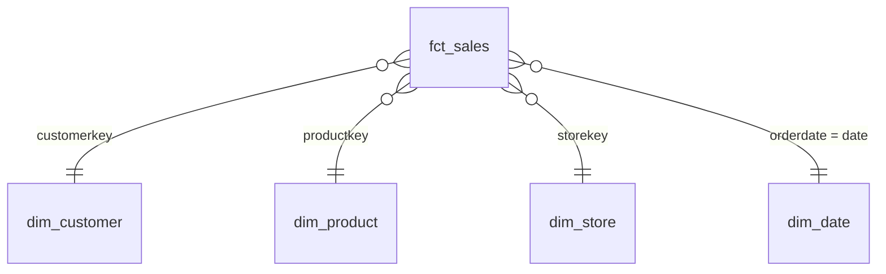

# Contoso Sales: from raw tables to a star schema with dbt

*Leer en español: [README.es.md](README.es.md)*

This is my first project with **dbt**. I deliberately kept the scope small and simple. The goal was not to build something complex, but to understand the fundamentals of the tool and compare them with the way I usually work.

In my job as a data analyst I build and maintain a PostgreSQL database with views and materialized views. It works, but the logic ends up spread across different views and in what I know about how they depend on each other. If a number comes out wrong, I have to trace by hand which view feeds which. I run checks as standalone queries, with nothing guaranteeing they always get run. With dbt I wanted to see whether the same work could be done with more transparency, more auditability and more control over errors.

## Starting point

I used the **Contoso** sample dataset (a fictional retail company), loaded into my local PostgreSQL. The version I used (`contoso_100k`) is the one Luke Barousse shares in his free course [Intermediate SQL for Data Analytics](https://github.com/lukebarousse/Int_SQL_Data_Analytics_Course) ([download](https://github.com/lukebarousse/Int_SQL_Data_Analytics_Course/releases/tag/v.0.0.0)). The data is not included in this repository.

It has six tables. The sales table holds every line of every order, with quantities, prices, discounts, currency and dates. The other five describe customers, products, stores and dates, and store exchange rates between currencies.

To give it a purpose, I imagined a scenario: I am the data person at Contoso, and the sales team asks me things like:

- How much did we sell by country and year, in dollars?
- Which product categories generate the most profit?
- How much revenue do we give up in discounts?
- Which age group buys the most?

To answer any of these on the raw tables, you have to guess how to join them and hope the JOIN doesn't duplicate rows. **My goal was not to answer the questions**, but to get the tables ready so that answering them is easy and safe, for me or for anyone else.

## The map

```
 SOURCES                  STAGING                 MARTS                   CONSUMPTION
 (public)               (standardize)          (dimensional model)      (analysis)
 sales              ──→    stg_sales       ──→    fct_sales       ──→    queries
 customer           ──→    stg_customer    ──→    dim_customer    ──→    dashboards
 product            ──→    stg_product     ──→    dim_product
 store              ──→    stg_store       ──→    dim_store
 date               ──→    stg_date        ──→    dim_date
 currencyexchange   ──→    stg_exchange

        TESTS: check conditions on the data every time the project is built
        DOCS:  describe every model and column, with the dependency graph
        GIT:   keeps the history of changes
```

The original tables stay in the `public` schema and are never modified. Everything dbt builds goes to a separate schema (`dbt_dev`).

What dbt lets me do is transform data through models written as SQL files. Each model is a `SELECT`, and dbt takes care of creating it as a view or a table and running them in the right order, because it knows which model depends on which. It also lets you add automated tests and generate documentation.

## How I built it

### 1. First, on paper

Before writing a single line, I sat down to understand the data. The first question for each table was: **what exactly does one row represent?** In data modeling this is called the table's *grain*. I verified it with SQL queries, not just by looking at the data:

| Table | One row is... | Identifying key |
|---|---|---|
| sales | one line of an order | `orderkey` + `linenumber` |
| customer | one customer | `customerkey` |
| product | one product | `productkey` |
| store | one store | `storekey` |
| date | one day | `date` |
| currencyexchange | the exchange rate between two currencies on one day | `date` + `fromcurrency` + `tocurrency` |

It looks like a detail, but it is what prevents the most expensive and most silent error in data: a JOIN that duplicates rows and inflates totals without anyone noticing.

With that I drew the **star**: sales in the center (the *facts*, what gets measured and summed) and around it the *dimensions*, which describe the who, what, where and when. Each sale has one customer, one product, one store and one date; each customer, product, store or date can appear in many sales.



### 2. The tools

- **PostgreSQL:** stores the original tables and the models dbt generates.
- **dbt:** defines, builds, tests and documents the transformations.
- **Python:** only to create an isolated environment and install dbt.
- **VS Code:** to edit the SQL and configuration files.

### 3. Staging: a standardized layer

I created one staging model for each original table. In this layer I kept the same grain and the same row count as the source, with no joins or filters: I only selected, ordered and standardized columns. It is little work, but it separates the raw data from what gets used, and if a source changes tomorrow, the fix is made in one place.

### 4. Marts: the star

On top of staging I built the four dimensions and the fact table. I materialized them as tables rather than views: they are what people will query, so it makes sense to have them computed and ready instead of recalculating joins and derived columns on every query.

| Model | One row is... | Rows |
|---|---|---|
| `fct_sales` | one line of an order | 199,873 |
| `dim_customer` | one customer | 104,990 |
| `dim_product` | one product | 2,517 |
| `dim_store` | one store | 74 |
| `dim_date` | one day, from 2015 to 2024 | 3,653 |

`fct_sales` has exactly the same rows as the original sales table: the grain was preserved.

This is the graph dbt generates from the references between models:


It shows dependencies from left to right: sources in green, then staging and the star. On the right are the tests I wrote by hand, connected to the models they check.

### 5. What I found in the data

This was the most interesting part. Looking at the data closely, things I didn't expect showed up:

- **Prices were already in dollars.** I started by assuming each sale was in the customer's currency. I checked it: the same product has the same price regardless of the sale's currency, and the exchange rate stored with each sale (the one for the day it was made) goes from USD to the local currency. That's why dollar amounts carry the `_usd` suffix and can be summed across countries. I also added a column with the amount in local currency, documented so that it is not summed across countries with different currencies.
- **`netprice` is the unit price after discount.** Compared with the list price, it is never higher, and about 62% of order lines have some discount.
- **Store status is not reliable.** An empty status usually means "open", but there are exceptions: store 630 has a close date and an empty status. So, to know whether a store is open, I used the close date instead of the status. I didn't modify the original data: I solved it in the model and documented it.

### 6. Tests: the checks I used to do by hand

This is the biggest difference from my usual way of working. The checks I used to run as standalone queries are now written once in the project, and `dbt build` runs them every time it rebuilds it: **18 tests** in total. If one day data arrives that breaks any of those conditions, dbt flags it before the number reaches a report.

| Type of check | What it verifies |
|---|---|
| Uniqueness | That dimension keys and order lines are not repeated. |
| Completeness | That the keys of the dimensions and of each order line are not empty. |
| Integrity | That every sale points to a customer, product, store and date that exist. |
| Business rules | That the discounted price never exceeds the list price, that there are no sales outside the period the store was open, and that nothing is delivered before it is ordered. |

### 7. Documentation

I documented the models and the columns needed to interpret the data correctly, with descriptions written next to the code. From that, dbt generates a browsable site with the graph above. The idea is that someone who doesn't know me can use the tables without asking me what each column means; for example, the difference between a customer's current age and the age they had when they bought.

### 8. The questions, answered

To prove the star works, I answered the four questions from the scenario with short queries on the final models: the fact table, one or two dimensions and a `GROUP BY`, without rebuilding relationships from the original tables. They are in `analyses/`.

| Question | How I measured it | Result |
|---|---|---|
| Sales by country and year | Net sales in USD, by store country | The United States leads among physical stores, but since 2021 the **online** store is the channel that sells the most (in 2022 it sold more than twice as much as the United States). All countries drop in 2020. |
| Categories with the most profit | (Discounted price − cost) × quantity, in USD | **Computers** brings in 44% of total profit (USD 50.2M of 114M). Margins are similar across categories (52% to 59%): volume makes the difference, not margin. |
| Revenue given up in discounts | List-price sales − net sales, in USD and as a ratio | USD 12.95M in total. Discounts stay steady at around **6%** of list-price sales every year. |
| Age group that buys the most | Net sales in USD and distinct customers, by age at purchase | "+66" comes first, but it is the only open-ended group and spans many more years than the others. Comparing groups of the same width (8 years), sales are similar (between USD 20M and 25M each): **no age group stands out**. |

Two things came up while answering them:

- The online store appears in `dim_store` with the country "Online". That's why it shows up as one more "country" in the first query. I left it that way because it shows the weight of the online channel, but it is worth keeping in mind when reading sales by country.
- Age groups need to have the same width to be compared. An open-ended group like "+66" can look like the most important one just because it covers more ages.

## Project outcome

- A staging layer that standardizes the six original tables.
- A star schema with one fact table and four dimensions.
- 18 automated tests for uniqueness, completeness, integrity and business rules.
- Documentation of models and columns, with the dependency graph.
- Four queries that answer business questions using only the star.
- Everything versioned with Git.

## Modeling decisions

| Decision | Why |
|---|---|
| Grain of `fct_sales` = order line | Keep the original level of detail and avoid duplicating amounts. |
| Source key names (`customerkey`...) in every layer | Be able to trace any column back to its origin. |
| Amounts with a `_usd` suffix, local currency kept separate | The name tells you what can and can't be summed. |
| Current age in `dim_customer`, age at purchase in `fct_sales` | They answer different questions: who the customer is today and who they were when they bought. |
| Open store = no close date | The status field has inconsistencies. |
| Marts as tables, staging as views | Staging is an intermediate step; marts are what gets queried. |
| Original data left untouched | Problems are solved in dbt and documented. |
| `stg_exchange` is kept even though it isn't used yet | It keeps the source available for a possible future currency analysis. |

## Scope

| Included | Out of scope |
|---|---|
| Transformation of the six original tables | Automated or scheduled loads |
| Staging layer and star schema | Incremental models and snapshots |
| Data quality tests | Orchestration |
| Documentation and example queries | Dashboards or BI integration |

## Next steps

- Repeat the exercise with a messier dataset, where an intermediate layer is needed to join tables with different grains.
- Add a dashboard on top of `fct_sales` to close the loop all the way to consumption.
- Try features left out here: incremental models, snapshots and scheduled runs.

## How to run it

Requirements: Python, PostgreSQL with the Contoso dataset loaded in the `public` schema, and dbt-postgres (I used dbt Core 1.13 and the postgres adapter 1.11).

```bash
python -m venv .venv
.venv\Scripts\Activate.ps1
pip install dbt-postgres
dbt debug
dbt build
dbt docs generate
dbt docs serve
```

- `dbt debug` checks the connection; `dbt build` builds all models and runs the tests; the last two generate and open the documentation.
- The connection is configured in `~/.dbt/profiles.yml` (host, port, database, user, password and target schema). The profile name must match the one in `dbt_project.yml`. That file contains credentials and is not part of the repository.

## Repository structure

```
models/
  staging/     one view per original table + _sources.yml (declares the sources)
  marts/       the star (fct_sales and 4 dimensions) + _marts.yml (tests and descriptions)
tests/         hand-written tests (grain and business rules)
analyses/      the queries that answer the questions
docs/          README images
dbt_project.yml
```
