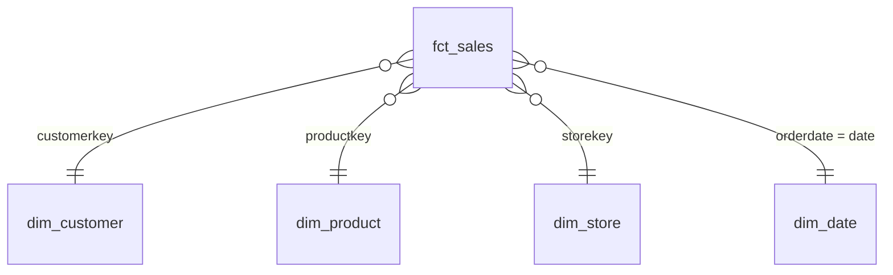
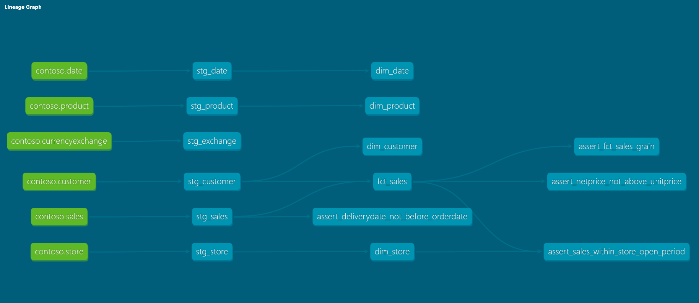

# Ventas de Contoso: de tablas crudas a un esquema estrella con dbt


Este es mi primer proyecto con **dbt**. Lo diseñé con un alcance acotado y sencillo a propósito. La idea no era construir algo complejo, sino entender los fundamentos de la herramienta y compararlos con mi forma habitual de trabajar.

En mi trabajo como analista de datos armo y mantengo una base en PostgreSQL con vistas y vistas materializadas. Funciona, pero la lógica queda repartida entre distintas vistas y en lo que yo sé sobre cómo dependen unas de otras. Si un número sale mal, tengo que rastrear a mano qué vista alimenta a cuál. Las verificaciones las hago con consultas sueltas, sin nada que garantice que se corran siempre. Lo que quería ver con dbt es si ese mismo trabajo se puede hacer con más transparencia, más auditabilidad y más control sobre los errores.

## El punto de partida

Usé el dataset de ejemplo **Contoso** (una empresa ficticia de retail), cargado en mi PostgreSQL local. La versión que usé (`contoso_100k`) es la que comparte Luke Barousse en su curso gratuito [Intermediate SQL for Data Analytics](https://github.com/lukebarousse/Int_SQL_Data_Analytics_Course) ([descarga](https://github.com/lukebarousse/Int_SQL_Data_Analytics_Course/releases/tag/v.0.0.0)). Los datos no están incluidos en este repositorio.

Tiene seis tablas. La de ventas contiene cada línea de cada pedido, con cantidades, precios, descuentos, moneda y fechas. Las otras cinco describen a los clientes, productos, tiendas y fechas, y guardan los tipos de cambio entre monedas.

Para darle sentido, me imaginé un escenario: soy el responsable de datos de Contoso y el equipo comercial me pregunta cosas como estas:

- ¿Cuánto vendimos por país y por año, en dólares?
- ¿Qué categorías de producto dejan más ganancia?
- ¿Cuánta plata resignamos en descuentos?
- ¿Qué rango de edad compra más?

Para contestar cualquiera de ellas sobre las tablas crudas, hay que adivinar cómo unirlas y esperar que el JOIN no duplique filas. **Mi objetivo no era responder las preguntas**, sino dejar las tablas listas para que responderlas sea fácil y seguro, para mí o para otros.

## El mapa

```
 FUENTES                  STAGING                 MARTS                   CONSUMO
 (public)               (estandarizar)         (modelo dimensional)     (análisis)
 sales              ──→    stg_sales       ──→    fct_sales       ──→    consultas
 customer           ──→    stg_customer    ──→    dim_customer    ──→    dashboards
 product            ──→    stg_product     ──→    dim_product
 store              ──→    stg_store       ──→    dim_store
 date               ──→    stg_date        ──→    dim_date
 currencyexchange   ─→     stg_exchange

        TESTS: verifican condiciones sobre los datos cada vez que se construye el proyecto
        DOCS:  describen cada modelo y columna, con el grafo de dependencias
        GIT:   guarda el historial de cambios
```

Las tablas originales quedan en el schema `public` y nunca se modifican. Todo lo que construye dbt va a un schema aparte (`dbt_dev`).

Lo que me permite dbt es transformar datos mediante modelos escritos en archivos SQL. Cada modelo es un `SELECT`, y dbt se encarga de crearlo como vista o tabla y de ejecutarlos en el orden correcto, porque sabe qué modelo depende de cuál. Además permite sumar tests automáticos y generar documentación.

## Cómo lo fui armando

### 1. Primero, en papel

Antes de escribir una línea, me senté a entender los datos. La primera pregunta para cada tabla fue: **¿qué representa exactamente una fila?** En modelado de datos esto se llama el *grano* de la tabla. Lo verifiqué con consultas SQL, no solo mirando los datos:

| Tabla | Una fila es... | Clave de identificación |
|---|---|---|
| sales | una línea de un pedido | `orderkey` + `linenumber` |
| customer | un cliente | `customerkey` |
| product | un producto | `productkey` |
| store | una tienda | `storekey` |
| date | un día | `date` |
| currencyexchange | el tipo de cambio entre dos monedas en un día | `date` + `fromcurrency` + `tocurrency` |

Parece un detalle, pero es lo que evita el error más caro y más silencioso en datos: un JOIN que duplica filas e infla los totales sin que nadie lo note.


Con eso dibujé la **estrella**: las ventas en el centro (los *hechos*, lo que se mide y se suma) y alrededor las *dimensiones*, que describen el quién, qué, dónde y cuándo. Cada venta tiene un cliente, un producto, una tienda y una fecha; cada cliente, producto, tienda o fecha puede aparecer en muchas ventas.




### 2. Las herramientas

- **PostgreSQL:** guarda las tablas originales y los modelos que genera dbt.
- **dbt:** define, construye, prueba y documenta las transformaciones.
- **Python:** solo para crear un entorno aislado e instalar dbt.
- **VS Code:** para editar los archivos SQL y de configuración.


### 3. Staging: una capa estandarizada

Creé un modelo de staging por cada tabla original. En esta capa mantuve el mismo grano y la misma cantidad de filas que la fuente, sin joins ni filtros: solo seleccioné, ordené y estandaricé columnas. Es poco trabajo, pero separa lo crudo de lo que se usa, y si mañana cambia una fuente, el ajuste se hace en un solo lugar.

### 4. Marts: la estrella

Sobre staging construí las cuatro dimensiones y la tabla de hechos. Las guardé como tablas y no como vistas: son las que se van a consultar, así que conviene que estén calculadas y listas, en lugar de recalcular los joins y las columnas derivadas en cada consulta.

| Modelo | Una fila es... | Filas |
|---|---|---|
| `fct_sales` | una línea de un pedido | 199.873 |
| `dim_customer` | un cliente | 104.990 |
| `dim_product` | un producto | 2.517 |
| `dim_store` | una tienda | 74 |
| `dim_date` | un día, de 2015 a 2024 | 3.653 |

`fct_sales` tiene exactamente las mismas filas que la tabla de ventas original: el grano se mantuvo.

Este es el grafo que genera dbt a partir de las referencias entre modelos:



Muestra las dependencias de izquierda a derecha: en verde las fuentes, después staging y la estrella. A la derecha aparecen los tests que escribí a mano, conectados a los modelos que verifican.

### 5. Lo que encontré en los datos

Esta fue la parte más interesante. Al mirar los datos de cerca aparecieron cosas que no esperaba:

- **Los precios ya estaban en dólares.** Empecé asumiendo que cada venta estaba en la moneda del cliente. Lo verifiqué y el mismo producto tiene el mismo precio sin importar la moneda de la venta, y el tipo de cambio que trae cada venta (el del día en que se hizo) va de USD a la moneda local. Por eso los montos en dólares llevan el sufijo `_usd` y se pueden sumar entre países. Agregué además una columna con el monto en moneda local, documentada para que no se sume entre países con monedas distintas.
- **`netprice` es el precio unitario con descuento.** Comparándolo con el precio de lista, nunca es mayor, y alrededor del 62% de las líneas de pedido tiene algún descuento.
- **El estado de las tiendas no es confiable.** Un estado vacío suele significar "abierta", pero hay excepciones: la tienda 630 tiene fecha de cierre y el estado vacío. Por eso, para saber si una tienda está abierta, usé la fecha de cierre y no el estado. Los datos originales no los modifiqué: lo resolví en el modelo y lo dejé documentado.

### 6. Tests: las verificaciones que antes hacía a mano

Acá está la diferencia más grande con mi forma de trabajar habitual. Las comprobaciones que antes corría sueltas ahora están escritas una sola vez en el proyecto, y `dbt build` las ejecuta cada vez que lo reconstruye: **18 tests** en total. Si un día llegan datos que no cumplen alguna de esas condiciones, dbt lo marca antes de que el número llegue a un informe.

| Tipo de control | Qué verifica |
|---|---|
| Unicidad | Que no se repitan las claves de las dimensiones ni las líneas de pedido. |
| Completitud | Que las claves no estén vacías. |
| Integridad | Que cada venta apunte a un cliente, producto, tienda y fecha que existan. |
| Reglas de negocio | Que el precio con descuento nunca supere al de lista, que no haya ventas después del cierre de una tienda y que nada se entregue antes de pedirse. |

### 7. Documentación

Documenté los modelos y las columnas que hacen falta para interpretar bien los datos, con descripciones escritas junto al código. Con eso dbt genera una página navegable con el grafo de arriba. La idea es que alguien que no me conoce pueda usar las tablas sin preguntarme qué significa cada columna; por ejemplo, la diferencia entre la edad actual de un cliente y la que tenía cuando compró.

### 8. Las preguntas, respondidas

Para probar que la estrella sirve, respondí las cuatro preguntas del escenario con consultas cortas sobre los modelos finales: la tabla de hechos, una o dos dimensiones y un `GROUP BY`, sin reconstruir relaciones desde las tablas originales. Están en `analyses/`.

| Pregunta | Cómo la medí | Resultado |
|---|---|---|
| Ventas por país y año | Venta neta en USD, por país de la tienda | Estados Unidos lidera entre las tiendas físicas, pero desde 2021 la tienda **online** es el canal que más vende (en 2022 facturó más del doble que Estados Unidos). Todos los países caen en 2020. |
| Categorías con más ganancia | (Precio con descuento − costo) × cantidad, en USD | **Computers** deja casi la mitad de la ganancia total (USD 50,2 M de 114 M). El margen es parecido en todas las categorías (52% a 59%): la diferencia la hace el volumen, no el margen. |
| Plata resignada en descuentos | Venta a precio de lista − venta neta, en USD y como proporción | USD 12,95 M en total. El descuento se mantiene estable en torno al **6%** de la venta a precio de lista todos los años. |
| Rango de edad que más compra | Venta neta en USD y clientes distintos, según la edad al comprar | "+66" aparece primero, pero es el único rango abierto y abarca muchos más años que los demás. Comparando rangos del mismo ancho (8 años), las ventas son casi iguales (unos USD 24 M cada uno): **ninguna edad se destaca**. |

Dos cosas que aparecieron al responderlas:

- La tienda online figura en `dim_store` con el país "Online". Por eso aparece como un "país" más en la primera consulta. Lo dejé así porque muestra el peso del canal online, pero vale tenerlo en cuenta al leer ventas por país.
- Los rangos de edad tienen que tener el mismo ancho para poder compararlos. Un rango abierto como "+66" puede parecer el más importante solo porque junta más edades.

## Resultado del proyecto

- Una capa staging que estandariza las seis tablas originales.
- Un esquema estrella con una tabla de hechos y cuatro dimensiones.
- 18 tests automáticos de unicidad, integridad y reglas de negocio.
- Documentación de modelos y columnas, con el grafo de dependencias.
- Cuatro consultas que responden preguntas de negocio usando solo la estrella.
- Todo versionado con Git.

## Decisiones de modelado

| Decisión | Por qué |
|---|---|
| Grano de `fct_sales` = línea de pedido | Mantener el nivel de detalle original y no duplicar montos. |
| Nombres de claves de la fuente (`customerkey`...) en todas las capas | Poder rastrear cualquier columna hasta su origen. |
| Montos con sufijo `_usd` y moneda local aparte | Que el nombre avise qué se puede sumar y qué no. |
| Edad actual en `dim_customer`, edad al comprar en `fct_sales` | Son preguntas distintas: quién es el cliente hoy y quién era cuando compró. |
| Tienda abierta = sin fecha de cierre | El campo de estado tiene inconsistencias. |
| Marts como tablas, staging como vistas | Staging es un paso intermedio; los marts son lo que se consulta. |
| Datos originales sin modificar | Los problemas se resuelven en dbt y quedan documentados. |
| `stg_exchange` se mantiene aunque hoy no se usa | Deja disponible la fuente para un posible análisis cambiario futuro. |

## Alcance

| Incluye | Fuera del alcance |
|---|---|
| Transformación de las seis tablas originales | Cargas automáticas o periódicas |
| Capa staging y esquema estrella | Modelos incrementales y snapshots |
| Tests de calidad de datos | Orquestación |
| Documentación y consultas de ejemplo | Dashboards o integración con BI |


## Próximos pasos

- Repetir el ejercicio con un dataset más desordenado (por ejemplo, Olist), donde haga falta una capa intermedia para unir tablas con granos distintos.
- Agregar un dashboard sobre `fct_sales` para cerrar el circuito hasta el consumo.
- Probar funcionalidades que acá quedaron afuera: modelos incrementales, snapshots y ejecución programada.

## Cómo correrlo

Requisitos: Python, PostgreSQL con el dataset Contoso cargado en el schema `public`, y dbt-postgres (usé dbt Core 1.13 y el adaptador postgres 1.11).

```bash
python -m venv .venv
.venv\Scripts\Activate.ps1
pip install dbt-postgres
dbt debug
dbt build
dbt docs generate
dbt docs serve
```

- `dbt debug` verifica la conexión; `dbt build` construye todos los modelos y corre los tests; los dos últimos generan y abren la documentación.
- La conexión se configura en `~/.dbt/profiles.yml` (host, puerto, base, usuario, contraseña y schema destino). El nombre del perfil tiene que coincidir con el de `dbt_project.yml`. Ese archivo tiene credenciales y no forma parte del repositorio.


## Estructura del repositorio

```
models/
  staging/     una vista por tabla original + _sources.yml (declara las fuentes)
  marts/       la estrella (fct_sales y 4 dimensiones) + _marts.yml (tests y descripciones)
tests/         tests escritos a mano (reglas de negocio)
analyses/      las consultas que responden las preguntas
docs/          imágenes del README
dbt_project.yml
```

---


